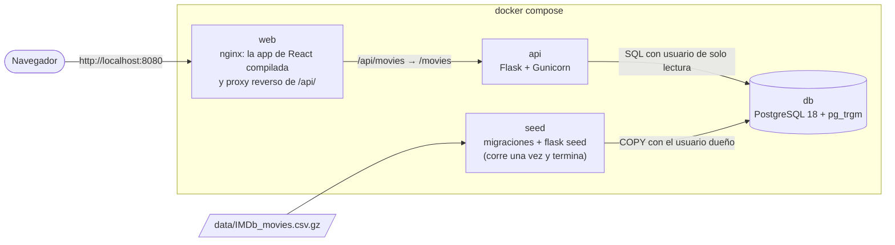
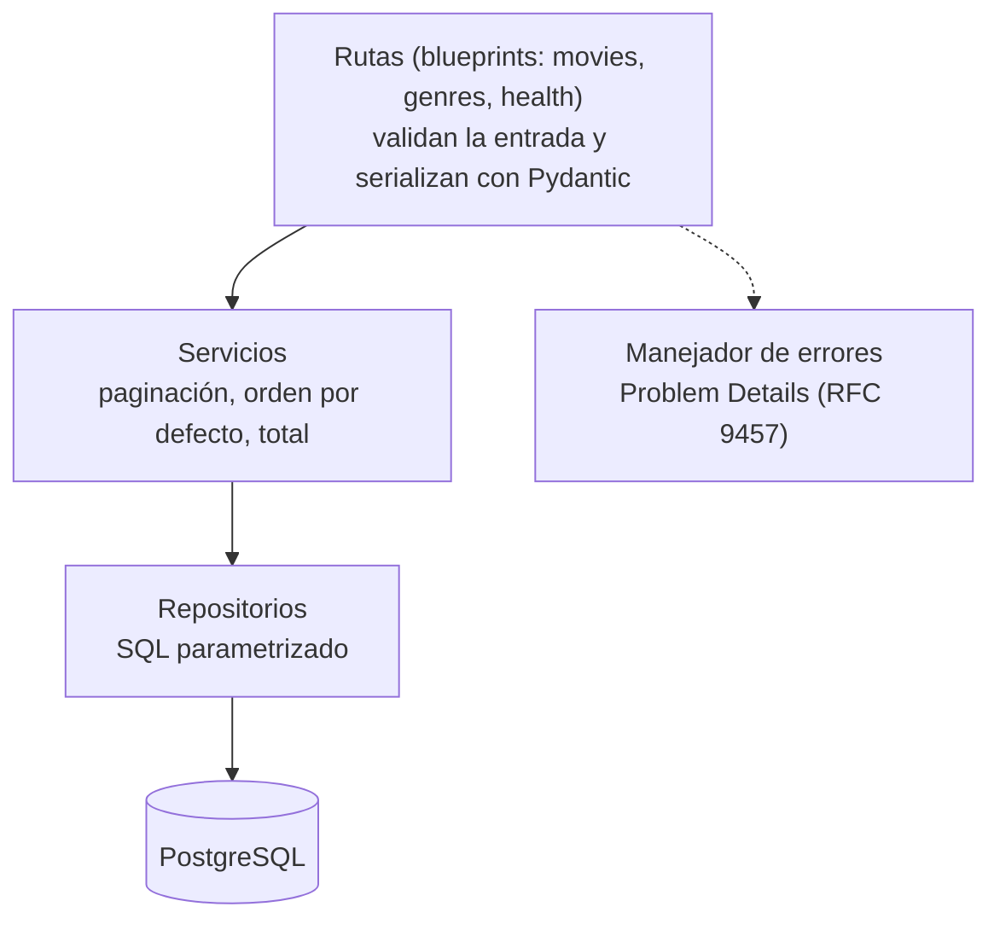

# Arquitectura y modelo de datos

## Vista general



- **Un solo origen.** El navegador habla solo con `web`, que sirve la app y pasa `/api/` a la API. Front y API
  quedan en el mismo origen, así que CORS no hace falta.
- **La API también se publica en `http://localhost:8000`**, para probarla con `curl` o Postman, como pide la
  consigna.
- **La base no se publica fuera de la red de Docker.**

### Orden de arranque

`docker compose up` levanta todo de cero, en este orden, y cada servicio espera a que el anterior esté listo:

| Servicio | Qué hace | Listo cuando |
|---|---|---|
| `db` | PostgreSQL 18 | `pg_isready` responde |
| `seed` | Aplica las migraciones y carga el CSV. Si ese mismo archivo ya está cargado, según su SHA-256, termina sin hacer nada | Termina con código 0 |
| `api` | Gunicorn con la app de Flask | `GET /health/ready` responde 200 |
| `web` | nginx con la app compilada | Responde en el puerto 8080 |

## Backend

Flask con *app factory* y *blueprints*, en tres capas finas:



- **Las rutas** no tienen lógica: validan, llaman al servicio y devuelven el modelo de respuesta.
- **Los servicios** no saben de HTTP; **los repositorios** no saben de reglas: solo arman SQL con parámetros.
  Cada capa se puede testear sola.
- **El acceso a la base** es con SQLAlchemy 2.0 en estilo Core (consultas explícitas, sin ORM implícito), que
  Alembic necesita para las migraciones.
- **La carga (`flask seed`) vive en el mismo paquete** que la API, con sus funciones de parseo puras y
  testeadas por separado.

Estructura de carpetas:

```text
backend/
  app/
    __init__.py         create_app()
    config.py           configuración desde variables de entorno
    security.py         límite de pedidos por IP y headers de seguridad
    api/                blueprints: movies, catalog (géneros y países), health
    services/           casos de uso: paginación, orden por defecto, catálogo por carga
    repositories/       SQL parametrizado
    schemas/            modelos de Pydantic (parámetros y respuestas)
    errors.py           Problem Details
    countries.py        nombre del país en el CSV → código ISO donde se pinta en el mapa
    text.py             plegado del texto, el mismo para la carga y para la búsqueda
    etl/                parseo, reglas del ADR 0003 y comando seed
  migrations/           Alembic
  scripts/              EXPLAIN de las consultas y medición de p50 y p95
  tests/                parseo, carga, API, seguridad, criterios de aceptación y fixtures/ (CSV chicos)
  Dockerfile
frontend/
  src/
    api/                cliente HTTP y tipos de la API
    components/         barra «Explorar por», menús, grilla, tabla, póster, estados, marco de la página
    features/countries/ el mapa: formas de Natural Earth, proyección y componente
    hooks/              catálogo, vista elegida, media queries, título de la pestaña
    lib/                estado en la URL, formatos es-AR, géneros, países, pósters
    pages/              explorar, detalle, por país, 404 y error
    styles/             paleta y estilos globales
    test/               MSW con los datos de prueba y helpers
  nginx/                configuración y headers de seguridad
  Dockerfile
db/init/                crea el usuario de solo lectura de la API
scripts/                perfilado del CSV, benchmark de almacenamiento y armado del mapa
data/IMDb_movies.csv.gz
docker-compose.yml
.github/workflows/      CI
```

## Frontend

React con TypeScript y Vite.

- **TanStack Query** para pedir los datos. Resuelve, con una sola dependencia, tres cosas que a mano llevan
  código propenso a errores:
  - cancela los pedidos viejos, así una respuesta lenta no pisa a una nueva;
  - mantiene los resultados anteriores mientras llegan los nuevos, sin parpadeo;
  - cachea cada combinación de parámetros.
- **El estado vive en la URL** (`?q=&page=&genre=&sort=`), con React Router. Se puede compartir, recargar y
  usar el botón atrás.
- **Tres rutas:**
  - `/` explora y busca;
  - `/movies/:id` muestra el detalle, con una URL que se puede compartir;
  - `/countries` muestra el mapa y la lista de países ([ADR 0009](decisions/0009-browse-by-country.md)).
- **Las tarjetas son pósters generados** con los datos de cada película
  ([ADR 0010](decisions/0010-generated-posters.md)).
- **El mapa usa d3-geo** para proyectar la geometría de Natural Earth. Se carga solo al abrir esa página, para
  no sumar peso a la principal.
- **React Router en modo datos** (`createBrowserRouter`): da la restauración del scroll al volver de un
  detalle, la carga diferida de la página por país y una página de error si algo falla al mostrar una ruta.
- **Al cambiar de página, el foco pasa al contenido**, para que un lector de pantalla empiece a leer ahí. Al
  escribir en la búsqueda no se mueve, porque solo cambia la query string.

## Modelo de datos

### Tabla `movies`

| Columna | Tipo | Restricciones y notas |
|---|---|---|
| `imdb_title_id` | `text` | Clave primaria; `CHECK` con el formato `tt` + 7 u 8 dígitos |
| `original_title` | `text` | `NOT NULL`. Es el título que se muestra |
| `italian_title` | `text` | `NOT NULL`. Es la columna `title` del CSV |
| `original_title_search`, `italian_title_search` | `text` | `NOT NULL`. Los títulos plegados: minúsculas, sin acentos y con ø, æ, ð y þ convertidas |
| `year` | `smallint` | `NOT NULL`, `CHECK` entre 1880 y 2100. El límite del año actual lo aplica la carga (regla 1): un `CHECK` no puede depender de la fecha |
| `genres` | `text[]` | `NOT NULL`, al menos uno. El CSV trae hasta 3, pero un `CHECK` con máximo rechazaría una película válida si un CSV futuro trajera más |
| `duration` | `smallint` | `NOT NULL`, minutos, `CHECK > 0` |
| `countries`, `languages`, `directors`, `writers`, `actors` | `text[]` | Listas, sin repetidos; `NULL` si el CSV no trae el dato. En `languages`, «None» significa sin diálogos |
| `production_company`, `description` | `text` | `NULL` si el CSV no trae el dato |
| `avg_vote` | `numeric(3,1)` | `NOT NULL`, `CHECK` entre 1 y 10 |
| `votes` | `integer` | `NOT NULL`, `CHECK >= 0` |
| `weighted_rating` | `double precision` | `NOT NULL`. Se calcula en la carga ([ADR 0008](decisions/0008-default-order.md)) |
| `metascore` | `smallint` | `CHECK` entre 0 y 100 |
| `reviews_from_users`, `reviews_from_critics` | `integer` | `CHECK >= 0` |
| `budget_amount`, `usa_gross_amount`, `worldwide_gross_amount` | `bigint` | `CHECK > 0`: un 0 se guarda como `NULL` |
| `budget_currency`, `usa_gross_currency`, `worldwide_gross_currency` | `char(3)` | Código ISO 4217. Monto y moneda son `NULL` los dos o ninguno |

**No se carga `date_published`:** es la fecha de estreno en Italia, la interfaz no la muestra y ninguna función
la usa ([ADR 0003](decisions/0003-data-cleaning-rules.md), regla 8). El CSV completo queda en el repo como
fuente.

### Índices

| Índice | Para qué |
|---|---|
| Clave primaria (`imdb_title_id`) | El detalle de una película |
| GIN con `gin_trgm_ops` en las dos columnas `*_search` | La búsqueda con `LIKE '%…%'` ([ADR 0005](decisions/0005-data-storage.md)) |
| B-tree en `(weighted_rating DESC, imdb_title_id)` | La lista por defecto, sin ordenar en cada request |
| GIN en `genres` | El filtro por género (`genres @> ARRAY['Drama']`) |
| GIN en `countries` | El filtro por país, que acepta varios a la vez (`countries && ARRAY['Russia', 'Soviet Union']`) |

Los otros órdenes (año, votos, duración, título) no tienen índice: con 85.855 filas, ordenar en memoria tarda
unos milisegundos, y `EXPLAIN ANALYZE` no mostró que hiciera falta ([performance.md](performance.md)).

### Qué se normaliza y qué no

- **Los géneros van en un `text[]` con índice GIN, sin tabla puente.**
  - Son 25 y cada película tiene como máximo 3. Solo se usan para filtrar y para mostrar, y el array alcanza
    para las dos cosas sin joins.
  - `GET /genres` sale de `unnest(genres)` con su conteo; es una consulta barata y cacheable.
  - Una tabla puente agregaría integridad referencial. Pero la carga ya valida los géneros, y un género nuevo
    no debe rechazar la fila: se muestra en inglés ([ADR 0002](decisions/0002-display-title-and-ui-language.md)).
- **Los países también van en un `text[]`**, con un índice GIN para el filtro. La correspondencia con los
  códigos ISO es una tabla en el código del backend, porque es un dato fijo de 194 nombres.
- **Directores, guionistas y actores no se normalizan.** Hay 417.320 actores distintos y ninguna función busca
  o filtra por persona: normalizarlos sumaría tablas y joins sin uso. Si más adelante hiciera falta buscar por
  persona, se agregaría un índice GIN sobre el array.

### Tablas de la carga

| Tabla | Contenido |
|---|---|
| `load_runs` | Una fila por carga: fecha, SHA-256 del archivo, filas leídas, cargadas y rechazadas, correcciones por regla, y C y m del rating ponderado. La API saca de acá el total sin filtros |
| `load_rejections` | Cada fila rechazada, con su número de línea, el motivo y su contenido original en `jsonb` |

### La carga, paso a paso

1. Calcula el SHA-256 del archivo. Si coincide con el de la última carga exitosa, termina.
2. Lee el `.gz` como texto y aplica a cada fila las reglas del [ADR 0003](decisions/0003-data-cleaning-rules.md).
   Una fila que no se puede interpretar va a `load_rejections` con su motivo; las demás siguen.
3. Calcula C y m, y el rating ponderado de cada película.
4. En una sola transacción, borra las películas con `DELETE`, carga las nuevas con `COPY` y registra la corrida en
   `load_runs`. Mientras tanto, la API sigue viendo los datos anteriores: `DELETE`, a diferencia de `TRUNCATE`,
   no bloquea las lecturas. Al terminar, `VACUUM` libera las filas borradas, sin el paso final que sí
   bloquearía, y `ANALYZE` actualiza las estadísticas.
5. Si los rechazos superan el 1 % de las filas, la transacción se cancela y el seed falla con el resumen. Con el
   CSV actual se espera 0.

### Usuarios de la base

- **El superusuario** solo administra, desde adentro del contenedor: por la red no puede entrar.
- **El dueño, `movies`,** (migraciones y seed) crea tablas y escribe, pero no es superusuario: con su
  contraseña no se pueden correr comandos en el servidor.
- **El de la API, `movies_api`,** solo puede leer (`SELECT`), todas sus transacciones son de solo lectura y
  tiene un `statement_timeout` de 5 s, para cortar cualquier consulta inesperadamente cara. Lo crea
  `db/init/01-roles.sh` cuando se crea la base.
- Las credenciales llegan por variables de entorno. En el repo solo está `.env.example`, sin valores reales.
